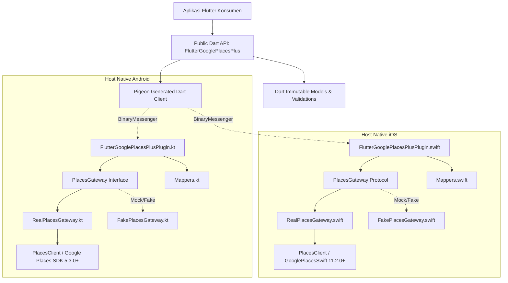

# Arsitektur `flutter_google_places_plus`

Dokumen ini menjelaskan arsitektur internal, pemisahan layer, aliran data, strategi penanganan kesalahan, dan batas pengujian (testability) untuk plugin `flutter_google_places_plus`.

---

## 1. Diagram Layer

---

## 2. Batas Tanggung Jawab

| Komponen | Tanggung Jawab | Hal yang Sengaja DIHINDARI |
|---|---|---|
| **Public Dart API** | Validasi input konsumen (mis. field mask tidak boleh kosong, validasi rentang koordinat), manajemen instance, lifecycle session token, ekspos model immutable, translasi error ke `PlacesException`. | Melakukan request HTTP manual atau menyimpan cache tempat sendiri. |
| **Pigeon Contract** | Satu-satunya sumber kebenaran (single source of truth) untuk struktur data dan method antara Dart dan Host Platform (Kotlin & Swift). Tipe aman tanpa string channel manual. | Menyertakan logika bisnis di file skema Pigeon. |
| **Native Plugin Layer (`FlutterGooglePlacesPlusPlugin`)** | Implementasi Pigeon Host API interface. Mengaitkan lifecycle Flutter (`FlutterPlugin`), menerima argumen Pigeon, mendelegasikan ke `PlacesGateway`, dan menangani thread/coroutine context. | Memanggil SDK Google secara langsung tanpa perantara gateway. |
| **`PlacesGateway` (Protocol / Interface)** | Kontrak abstraksi operasi Places: `initialize`, `findAutocompletePredictions`, `fetchPlace`. Memisahkan kode glue Flutter dari Google Places SDK konkret. | Menyentuh objek Flutter Engine (`FlutterPluginBinding`, dsb). |
| **`RealPlacesGateway`** | Implementasi gateway yang membungkus `PlacesClient` Google. Menangani coroutines (`Task.await()` di Kotlin) dan Swift concurrency (`async/await` di Swift). | Mengubah format data di luar tipe domain gateway. |
| **`Mappers` (Native)** | Mengonversi DTO Pigeon ke request SDK Google dan memetakan respons SDK Google ke DTO Pigeon. Murni fungsi deterministik (pure functions). | Efek samping (I/O, network, state). |

---

## 3. Aliran Data

### A. Alur Autocomplete (`findAutocompletePredictions`)
1. Pengguna mengetik teks di aplikasi Flutter.
2. `FlutterGooglePlacesPlus.findAutocompletePredictions(...)` dipanggil dengan query, session token, filter negara, dsb.
3. Parameter dikonversi ke DTO Pigeon `PigeonAutocompleteRequest` dan dikirim via Pigeon Host API.
4. Di sisi Native:
   - Plugin menerima request di background coroutine/task.
   - `Mappers` mengonversi `PigeonAutocompleteRequest` ke `FindAutocompletePredictionsRequest` (Android) atau `AutocompleteRequest` (iOS).
   - `PlacesGateway.findAutocompletePredictions(...)` dieksekusi memanggil Google Places SDK.
   - Hasil SDK dikonversi oleh `Mappers` ke `List<PigeonAutocompletePrediction>`.
5. Pigeon mengembalikan respons ke Dart.
6. Dart mengonversi DTO Pigeon ke model immutable publik `AutocompletePrediction` lengkap dengan helper method.

### B. Alur Fetch Place Details (`fetchPlace`)
1. Pengguna memilih salah satu prediksi autocomplete.
2. `FlutterGooglePlacesPlus.fetchPlace(placeId: ..., fields: {...}, sessionToken: ...)` dipanggil.
3. Field mask divalidasi tidak kosong di Dart.
4. DTO Pigeon `PigeonFetchPlaceRequest` dikirim ke Native.
5. Di sisi Native:
   - `Mappers` menerjemahkan field enum Dart ke `List<Place.Field>` (Android) atau `[PlaceProperty]` (iOS).
   - `PlacesGateway.fetchPlace(...)` memanggil Places SDK dengan session token yang sama (menutup sesi penagihan).
   - Objek `Place` dari SDK dipetakan ke `PigeonPlace` yang bersih.
6. Pigeon mengembalikan respons ke Dart.
7. Dart menyajikan `Place` publik ke aplikasi.

---

## 4. Strategi Penanganan Kesalahan (Error Handling)

- **Tidak ada kebocoran detail mentah / API key**: Pesan error native disaring agar tidak pernah mencantumkan API key atau URL internal dengan credential.
- **Hierarki Error di Dart**:
  - `PlacesException`: Exception umum dengan `code` terstruktur dan `message` informatif:
    - `INVALID_ARGUMENT`: Input tidak valid (mis. query kosong atau field mask kosong).
    - `NOT_INITIALIZED`: Plugin belum diinisialisasi dengan API key.
    - `API_ERROR`: Error dari backend Google (mis. `REQUEST_DENIED`, `OVER_QUERY_LIMIT`, `NOT_FOUND`).
    - `NETWORK_ERROR`: Kegagalan koneksi jaringan.
    - `UNKNOWN`: Error tidak terduga.

---

## 5. Strategi Testabilitas (Test Boundaries)

1. **Dart Unit Tests**:
   - Mengetes model domain (`Place`, `AutocompletePrediction`, `LatLng`, `LatLngBounds`).
   - Mengetes serialisasi, `==`, `hashCode`, `toString`.
   - Mengetes `FlutterGooglePlacesPlus` client dengan fake/mock Pigeon Host API.
2. **Native Unit Tests (Kotlin & Swift)**:
   - Menguji `Mappers` secara menyeluruh dengan data statis tanpa membutuhkan koneksi jaringan atau inisialisasi context Google Places asli.
   - Menguji alur plugin menggunakan `FakePlacesGateway` yang mensimulasikan respons sukses dan error dari SDK Google.
3. **End-to-End Example**:
   - Menjalankan aplikasi contoh di simulator/device dengan input API key nyata (atau dummy untuk smoke test UI).
